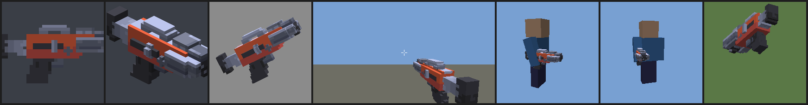

# lairner-pack

Resource pack for the **Defusal** mode of the lairner Minecraft server
(`play.lairner.com`). Minecraft Java **26.3** (resource pack format 97).
The defusal server adds it on join and removes it on leave; the other
servers don't use it.

**Download:** https://raw.githubusercontent.com/TimAnthonyAlexander/lairner-pack/main/dist/lairner-pack.zip
(SHA-1 in `dist/lairner-pack.zip.sha1`).



## Contents (namespace `lairner`, all under `df/`)

### Item models

Set `item_model` on any base item, e.g. `minecraft:item_model="lairner:df/ak"`.

| id | Shown as | Source |
|---|---|---|
| `lairner:df/glock` | G18 | own |
| `lairner:df/usp` | USP | own: black USP-S with a long suppressor, raised sights, hammer (2026-11-01) |
| `lairner:df/deagle` | D-Eagle | own |
| `lairner:df/mac10` | M10 | own: black boxy MAC-10, threaded barrel, magazine in the grip, folded wire stock (2026-11-01) |
| `lairner:df/mp9` | MP9 | own: black polymer MP9, top rail, foregrip, magazine in the grip, skeleton stock (2026-11-01) |
| `lairner:df/ak` | AK | own |
| `lairner:df/m4s` | M4-S | own: black M4A1-S, slim handguard, long suppressor, flat-top rail, collapsible stock (2026-11-01) |
| `lairner:df/knife` | Knife | own |
| `lairner:df/bomb` | Bomb (C4) | own |
| `lairner:df/kit` | Defuse kit | own |
| `lairner:df/flashbang` | Flash | Kenney grenade-a, recolored white |
| `lairner:df/smoke` | Smoke | Kenney grenade-a, recolored green |
| `lairner:df/he` | HE | Kenney grenade-b |
| `lairner:df/smoke_puff` | (item display) smoke cloud piece, 16 units wide, centered | Kenney smoke, gray |

Guns and the knife set `hand_animation_on_swap: false`, so changing the
stack (ammo in components) doesn't replay the equip bob.

Models: barrel along -Z, top +Y, centered on (8, 8, 8). One shared palette
texture (`lairner:item/df/palette`, 8x8 px per color so mipmaps stay clean).
Previews of every model in GUI, first person, third person and on the ground
are in `previews/` (rendered by `tools/preview.py` with the client's own
transform chain; real in-game look may differ slightly).

### Sounds (`assets/lairner/sounds.json`)

| Event | Range (blocks) |
|---|---|
| `lairner:df.glock.shot`, `df.mac10.shot`, `df.mp9.shot` | 56 |
| `lairner:df.ak.shot`, `df.deagle.shot` | 72 |
| `lairner:df.usp.shot`, `df.m4s.shot` (silenced) | 22 / 24 |

Voice lines (`lairner:df.voice.*`, 2026-11-01, `tools/voice.py`). Announcer, old-school robotic TTS (eSpeak NG
via the `espeakng_loader` wheel, deep, lo-fi: 11 kHz, telephone band, light bit crush): `planted`, `defused`,
`ctwin` ("Counter-Terrorists win."), `twin`. Everything the players say is ElevenLabs Eleven v3 (`eleven_v3`,
Creator plan; API output cached in `source/eleven/`, so a rebuild costs nothing): grenade callouts per side,
6 lines each (`he_ct`, `he_t`, `flash_ct`, `flash_t`, `smoke_ct`, `smoke_t`: "Fire in the hole!", "Flashbang
out!", "Smoke out!", ...), American soldiers shouting (v3 tags `[shouting]`, `[excited]`, `[aggressive]`,
`[battle cry]`, stability 0.0 "Creative"; British only for the SAS lines, Australian for the "bloody" ones); round start lines, 32 per side (`goct1`-`goct32`, `got1`-`got32`: the CS2 agents' round start
lines such as "Bingo, bango, bongo; bish, bash, bosh." and the classics). Range 16 (played at each listener)
/ 28 (callouts, from the thrower).

The gunshots are Tim's own recordings (2026-11-01; `source/tim/shots/<weapon>_<n>.flac`, one
sound entry per recording, the client picks one at random): G18 2, USP-S 3, Desert Eagle 2, MAC-10 3,
MP9 4, AK 1, M4-S 1. `python3 tools/sounds.py --tim-shots` rebuilds just them (no library sources needed).

| `lairner:df.reload.pistol` (2.2 s), `df.reload.smg` (2.7 s), `df.reload.rifle` (2.5 s) | 12 |
| `lairner:df.dryfire` | 10 |
| `lairner:df.hit`, `df.headshot` (for the shooter) | 8 |
| `lairner:df.headshot.kill` (headshot kill), `df.headshot.hit` (headshot, no kill); world sounds at the victim, mono | 80 / 80 |
| `lairner:df.knife.swing`, `df.knife.hit` | 12 / 16 |
| `lairner:df.bomb.beep` | 24 |
| `lairner:df.bomb.key` (one keypad press while planting), `df.bomb.plant` (armed) | 12 / 32 |
| `lairner:df.bomb.defuse` (defuse starts: a synthesized digital triple beep, `sounds.py --defuse`), `df.bomb.defused` | 16 / 32 |
| `lairner:df.bomb.explode` | 160 |
| `lairner:df.flash.ring` (for the flashed player), `df.flash.explode` | 8 / 64 |
| `lairner:df.grenade.bounce` | 20 |
| `lairner:df.he.explode` | 96 |
| `lairner:df.smoke.pop` (pop + 3.5 s hiss) | 32 |

Shots have 2-3 variants picked at random. Range is the
`attenuation_distance`: the client fades linearly to silence at
`attenuation_distance * max(volume, 1)`. Play them with volume 1 (lower for
quieter) and send them per player (`Player#playSound(Location, ...)`):
`World#playSound` only sends to players within `16 * max(volume, 1)` blocks.

### Font `lairner:df` and HUD

| Char | What | Use |
|---|---|---|
| `` | crosshair | title |
| `` | hit marker | title |
| `` | headshot marker | title |
| `` | full-screen white flash | title |
| `` `` `` `` | bomb, kit, armor, helmet icons | action bar (normal line height) |
| ``-`` | space -1, -2, -4 ... -128 | layout |
| ``-`` | space +1, +2, +4 ... +128 | layout |

Title glyphs are centered on the screen: the title is drawn at 4x scale
from the screen center with text y = -10, so a glyph of height H is
centered with ascent H/2 - 3; images have an even width and an invisible
(alpha 1) pixel in the last column so the measured width centers them
exactly. Send them as the title with `"font": "lairner:df"` and
`"shadow_color": 0` (titles draw a shadow otherwise). Fade with the
title times.

**Flash:** `` is a 32x16 white image drawn 1024 text units high and
2048 wide; at title scale that is 8192 GUI pixels wide and 4096 high, more than the
screen at any GUI scale up to 8K at GUI scale 1, so it covers the whole
screen. The title fade-out fades it. Alternative that is exact at any
window size: an `equippable` head item with
`camera_overlay: "lairner:df/flash_<10..100>"` (ten opacity steps are in
`textures/df/`), stepped down each tick.

**Vanilla overrides** (only while this pack is loaded): the crosshair
sprite is a CS-style static crosshair (four lines, gap), and the food bar
sprites are transparent (sprint is blocked by keeping food at 6).

## Layout

```
pack/                 the pack as zipped (pack.mcmeta, pack.png, assets/)
dist/                 lairner-pack.zip (+ .sha1), committed for the raw URL
source/kenney/        the Kenney meshes and colormap the models come from
previews/             renders of every model
tools/
  build.py            regenerate models + textures, validate, zip, print SHA-1
  models.py           OBJ -> cuboid models, own models, palette, item definitions
  voxelize.py         voxelizer and box merger
  textures.py         font glyphs, HUD icons, flash overlays, hidden food bar, pack.png
  sounds.py           sound recipes (needs the source libraries, see below)
  render.py, preview.py  software previews
  pngio.py            PNG read/write (stdlib)
```

## Rebuild

Python 3 (stdlib only) and ffmpeg with libvorbis.

```
python3 tools/build.py          # models + textures + checks + dist zip
python3 tools/preview.py        # previews/*.png
```

Sounds are committed as OGG. To rebuild the library and synthesized ones, download The Free Firearm
Sound Library ("Prepared SFX Library.7z") and the four Kenney audio packs
(RPG Audio, Impact Sounds, Interface Sounds, Sci-fi Sounds), extract each
Kenney pack into `<dir>/<rpg-audio|impact-sounds|interface-sounds|sci-fi-sounds>/`,
then:

```
python3 tools/sounds.py --ffsl "<path>/Prepared SFX Library" --kenney <dir>
python3 tools/build.py
```

The zip is reproducible (sorted entries, fixed timestamps): the same
inputs give the same SHA-1. After a change, commit `dist/` too; the server
config needs the new SHA-1.

Credits and licenses: [LICENSE.md](LICENSE.md).
